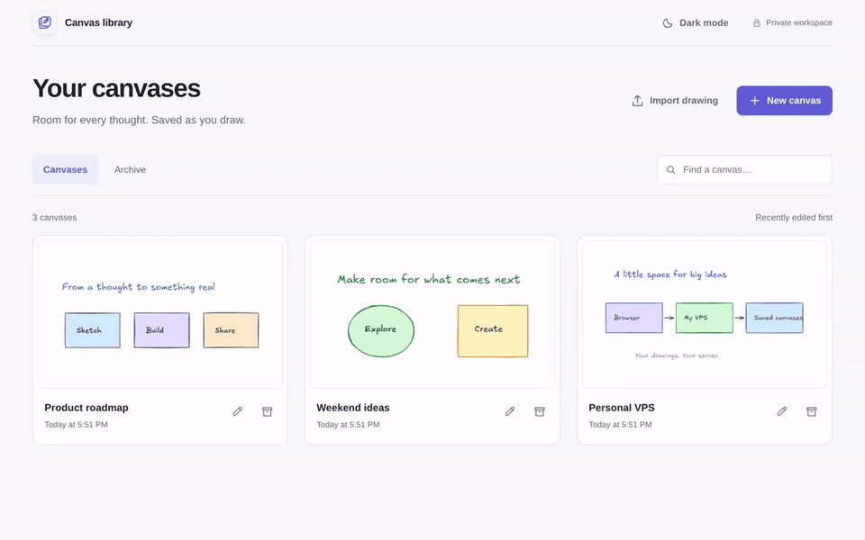

# Excalidraw Enhanced

My personal fork of [Excalidraw](https://github.com/excalidraw/excalidraw),
with enhancements I added for my own workflow and for self-hosting on my
personal VPS.

## Quick demo

[](https://raw.githubusercontent.com/itsmejay80/excalidraw-enhanced/main/docs/media/excalidraw-enhanced-demo.mp4)

A short walkthrough of the canvas library, editing, light/dark mode, autosave,
renaming, and creating a new canvas. [Watch or download the MP4](https://raw.githubusercontent.com/itsmejay80/excalidraw-enhanced/main/docs/media/excalidraw-enhanced-demo.mp4).

## What I added

I wanted a single place to keep multiple drawings, reopen them from any of my
devices, and let MCP clients work with a specific canvas. This fork adds a
self-hosted workspace around the Excalidraw editor:

- **Canvas library:** create, name, search, rename, archive, and restore drawings.
- **Persistent drawings:** each canvas has its own URL, saved scene, images,
  and snapshots, with autosave and live updates.
- **Canvas-specific MCP tools:** create and select canvases explicitly so AI
  clients can work on separate drawings.
- **Drawing imports:** bring in `.excalidraw` files or a previous browser drawing.
- **Shared appearance:** a saved light/dark preference across the library and editor.
- **More drawing space:** a compact canvas header with an integrated save indicator.
- **Personal deployment:** configurable storage paths, a systemd deployment
  script, versioned releases, backups, and private access through Tailscale.

The workspace application lives in
[`canvas-workspace/`](./canvas-workspace/README.md). See its README for setup,
configuration, deployment, and tests. These additions reflect my personal
setup; you can adapt them for your own VPS or self-hosted environment.

This fork starts from an Excalidraw source snapshot at upstream commit
`701b901`. The canvas engine and adapted editor build on
[yctimlin/mcp_excalidraw](https://github.com/yctimlin/mcp_excalidraw).
The project retains the [MIT license](./LICENSE) and the adapted editor's
[upstream license](./canvas-workspace/frontend/vendor/LICENSE).

## Getting started

Follow the [workspace setup guide](./canvas-workspace/README.md#run-locally)
to build the canvas engine, install dependencies, and start the application.
The app runs on `http://127.0.0.1:9124` by default.

For personal VPS hosting, see [configuration](./canvas-workspace/README.md#configuration)
and [private deployment](./canvas-workspace/README.md#private-deployment).
For AI clients, see the [MCP connection instructions](./canvas-workspace/README.md#mcp-clients).

## Development

From the `canvas-workspace` directory:

```bash
npm ci
npm run build
npm test
```

See the setup guide for the required canvas engine and browser test dependencies.
Report issues and suggest improvements in
[this repository](https://github.com/itsmejay80/excalidraw-enhanced/issues).
